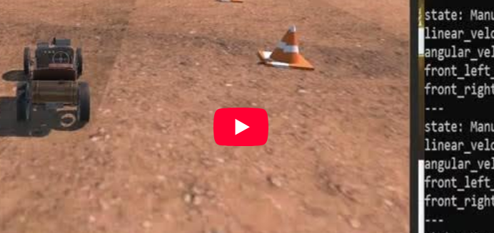

# ROS Input and Output

## Overview

The main purpose is simple: send driving commands from ROS 2 into Unity, let the vehicle respond using its actual driving and steering physics, and then publish the resulting vehicle state right back to ROS 2.

This gives us a complete two-way communication loop:

```text
       ROS 2 Command
            ↓
  /input Topic Source
            ↓
ugv_assignment_msgs/Input
            ↓
    Unity Subscriber
            ↓
    Vehicle Controller
            ↓
Throttle / Brake / Steering
            ↓
     Vehicle Physics
            ↓
Vehicle State Calculation
            ↓
ugv_assignment_msgs/Output
            ↓
    /feedback Topic
            ↓
  ROS 2 Terminal Tools
```

The scenario uses the custom `ugv_assignment_msgs/Input` and `ugv_assignment_msgs/Output` messages created specifically for this project.

**Evaluation Video**

🎥 **[Watch the ROS Input & Vehicle Feedback Demonstration](https://www.youtube.com/watch?v=wvYu8hE7G8I)**
[](https://www.youtube.com/watch?v=wvYu8hE7G8I)

---

# 1. Objective

The goal of this scenario was to prove that ROS 2 can actively control the Unity vehicle and receive meaningful feedback from the simulation.

This scenario validates:
* **ROS 2 Input:** Successfully receiving throttle, brake, and steering commands from ROS 2.
* **Vehicle Control:** Seamlessly applying those commands to the actual Unity vehicle.
* **Ackermann Steering:** Converting a single steering command into the correct independent front wheel angles.
* **Vehicle Physics:** Allowing the Rigidbody, wheels, and suspension components to react naturally.
* **ROS 2 Output:** Sending the resulting vehicle state back to ROS 2.
* **Live Feedback:** Monitoring velocity, steering values, and vehicle state parameters in real time.
* **Two-Way Communication:** Proving that data flows successfully in both directions.

The important part of this scenario is that the output is not simply a copy of the input command. The input controls the vehicle, the Unity physics system updates the vehicle state over terrain, and the resulting state is then published back to ROS 2.

---

# 2. ROS Initialization and ROS Bag Creation

Before launching Unity, we need to spin up our ROS 2 environment and launch the network handshake bridge. Open your terminal and run:

```bash
# Set up your ROS 2 Humble environment
source /opt/ros/humble/setup.bash

# Start the connection bridge between Unity and ROS 2
ros2 run ros_tcp_endpoint default_server_endpoint
```

Once Unity starts and connects successfully, the vehicle begins subscribing to control messages and publishing feedback.


### Checking Active Topics
To confirm that the Unity vehicle has successfully joined the ROS graph, open a new terminal window and look at the active nodes:

```bash
ros2 topic list
```

The main channels for this scenario should include the vehicle input and feedback topics. You can inspect the live feedback data values using the `echo` command:

```bash
# Monitor incoming vehicle state and telemetry data
ros2 topic echo /feedback
```

You can also check whether Unity is actively publishing feedback at the proper speed by running:

```bash
ros2 topic hz /feedback
```


### Recording the Session
We log the entire communication session into a ROS bag named `ros_input_output1` so we can inspect both sides of the loop later:

```bash
ros2 bag record -o ros_input_output1 /input /feedback /tf /joint_states
```

[PLACE ROS BAG RECORDING SCREENSHOT HERE]

Once recorded, the communication session can be replayed at any time without running the Unity simulation. Just use:

```bash
ros2 bag play ros_input_output1
```

This makes it easy to review exactly which commands were sent and how the Unity vehicle responded under load.

---

# 3. Things Used and Created

### Custom ROS 2 Messages
This scenario relies on custom ROS 2 messages built specifically for controlling and monitoring our UGV.

#### Vehicle Input (`ugv_assignment_msgs/Input`)
The Unity vehicle listens to this topic to intercept incoming control packets. It contains:
* `float64 throttle` — Controls vehicle acceleration.
* `float64 brake` — Applies physical braking force.
* `float64 steering_angle` — Controls the heading direction of the front wheels.

#### Vehicle Output (`ugv_assignment_msgs/Output`)
Unity bundles the vehicle's physical reactions and broadcasts them back to ROS using this topic. It contains:
* `string state` — Current operational status of the vehicle.
* `float64 linear_velocity` —  forward speed.
* `float64 angular_velocity` — Current rotational speed.
* `float64 front_left_steering_angle` — Exact angle of the front left tire.
* `float64 front_right_steering_angle` — Exact angle of the front right tire.

### Unity Vehicle Setup
* Direct network link via the ROS-TCP Connector script.
* Dedicated subscriber node to process incoming drive variables.
* Active feedback publisher node to send live physics metrics back out.
* Embedded Ackermann math blocks to split wheel tracking.
* Fully physics-driven Rigidbody car body with active four-wheel suspension.


---

# 4. Sending Control Commands

The vehicle receives all driving commands through the `/input` topic. 

### Message Specification
* **Message Type:** `ugv_assignment_msgs/msg/Input`
* **Available Parameters:** `throttle`, `brake`, `steering_angle`

To send a simple forward movement command from your terminal, run:

```bash
ros2 topic pub --once /input ugv_assignment_msgs/msg/Input "{throttle: 50.0, brake: 0.0, steering_angle: 0.0}"
```

To test how the vehicle handles a basic turn, use this command:

```bash
ros2 topic pub --once /input ugv_assignment_msgs/msg/Input "{throttle: 30.0, brake: 0.0, steering_angle: 0.3}"
```


---

# 5. Vehicle Feedback

Once the Unity engine finishes processing a physics update, it collects the vehicle's actual state and streams it back to ROS 2.

This step is critical because it tells ROS 2 what the vehicle is **actually doing** in the environment rather than what it was **told to do**. For instance, sending a single steering value to the vehicle results in two completely separate wheel angles in the output log, demonstrating that our Ackermann link is actively working.

---

# 6. Active ROS 2 Data Channels

You can easily audit or trace our entire control loop by monitoring these core topics:

| Direction | Topic | Purpose |
| :--- | :--- | :--- |
| **ROS 2 → Unity** | `/input` | Sends throttle, brake, and steering commands |
| **Unity → ROS 2** | `/feedback` | Publishes vehicle state and motion feedback |
| **Unity → ROS 2** | `/tf` | Publishes vehicle and sensor transforms |
| **Unity → ROS 2** | `/joint_states` | Publishes vehicle wheel and joint information |


This centralized communication loop operates smoothly alongside our existing sensor pipelines. This means you can actively steer the car via remote ROS commands while simultaneously streaming fresh GPS, IMU, Camera, and LiDAR packets.

---

# 7. Optimization

We optimized our communication scripts to prevent network traffic from clogging Unity's main rendering frames.

To keep data pipelines fast and light:
* Incoming control messages are processed only when ROS 2 pushes them.
* Telemetry updates use controlled time intervals (`InvokeRepeating`) instead of running every frame inside the main `Update()` block.
* The vehicle physics engine calculates tire grip and suspension loads completely independently.
* The feedback script strictly limits its focus to the specific variables demanded by our custom message structure.

Enforcing these strict update rates cuts down on unnecessary network overhead while providing highly accurate status summaries. This optimization is crucial since Unity is simultaneously running wheel colliders, rendering visual frames, computing LiDAR raycasts, and broadcasting transform arrays.

---

# 8. Challenges

* **Matching ROS Ranges with Vehicle Logic:** We had to spend extra time scaling the incoming values from ROS 2 so they matched the exact ranges expected by our vehicle's torque and braking controllers.
* **Ackermann Steering Translation:** Mapping a generic steering input value so it drives the front left and front right wheel links correctly without introducing jerky motion or physics errors was a significant technical challenge.
* **Real Feedback vs Input Echoing:** The output calculations had to extract the true simulated vehicle state rather than lazily bouncing the original input metrics back out to the ROS node.
* **Publishing Traffic Timing:** Broadcasts had to be throttled to clear out potential socket congestion while staying synchronized across systems.
* **Full-Loop Hardware Coordination:** Synchronizing multi-window linux terminals alongside Unity scene timelines required strict runtime connection setups to guarantee zero frame drops.

---

# 9. Future Improvements

* Injecting detailed runtime diagnostic fields directly into the output message stack.
* Create automated tests that send predefined control commands and verify the resulting vehicle state.

---

# 10. Key Takeaways

* How to receive custom ROS 2 messages inside Unity.
* How to convert ROS control values into vehicle throttle, brake, and steering.
* Create automated tests that send predefined control commands and verify the resulting vehicle state.
  
