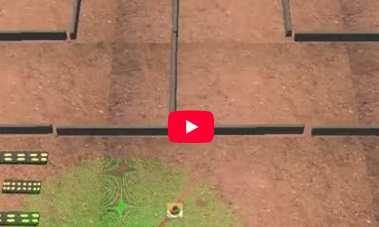

# Obstacle Scene

## Overview

We built this scene to test how well the vehicle handles, steers, and communicates under realistic conditions. It lets us evaluate Ackermann steering, 4 wheel suspension, ROS 2 communication, sensor publishing, and live vehicle feedback.
The entire testing loop was built from scratch. To meet the bonus requirements for custom assets, I modeled and prepared the custom obstacles ourselves using Blender. Have attached the blend file in the repository.

**Evaluation Video**

🎥 **[Watch the Ackermann steering in obstacle scene](https://www.youtube.com/watch?v=lUshATn7ntE)**
 [](https://www.youtube.com/watch?v=lUshATn7ntE)

---

# 1. Objective

The goal here was to create a custom obstacle course that forces the vehicle to turn and maneuver rather than just drive in a straight line. 

This scenario proves that the following features work seamlessly together:
* **Ackermann Steering:** Different front wheel steering angles during turns.
* **Core Driving:** Smooth acceleration, braking, and steering response.
* **Course Navigation:** Driving through a maze of objects.
* **Suspension System:** Real time movement of all 4 wheels over the terrain.
* **ROS 2 Integration:** Reliable control inputs coming in and car feedback going out.
* **Sensor Streams:** Constant updates from the GPS, IMU, Camera, and LiDAR sensors.
* **Data Logging:** Complete ROS bag recordings for later playback and analysis.


---

# 2. ROS Initialization and ROS Bag Creation

Before hitting play in Unity, we need to set up our ROS 2 environment and launch the network handshake bridge. Open your terminal and run:

```bash
# Set up your ROS 2 environment
source /opt/ros/humble/setup.bash

# Start the connection bridge between Unity and ROS
ros2 run ros_tcp_endpoint default_server_endpoint
```

### Checking Active Topics
Once Unity connects to the bridge, it starts streaming live data. If you want to verify that the topics are active and see the exact data running through them, open a new terminal window and use the `echo` command:

```bash
# View live data on a specific topic (e.g., LiDAR or Feedback)
ros2 topic echo /lidar
ros2 topic echo /feedback
```

### Recording the Session
We log the entire run into a ros bag named `obstacle1` so we can inspect the data later without re-running the simulator. To record the specific vehicle state, control, and sensor data, run:

```bash
ros2 bag record -o obstacle1 /input /feedback /gps /imu /camera /lidar /tf /joint_states
```


Once finished, this recorded data package can be replayed at any time to verify sensor accuracy or analyze the path taken.

---

# 3. Things Used and Created

### Environment
* A custom driving track built specifically for vehicle evaluation.
* Solid, fixed obstacles modeled in Blender.
* Different Camera Angles and LiDAR debug rays.

### Vehicle Setup
* Our standard Unmanned Ground Vehicle (UGV) car prefab.
* Functional Ackermann steering geometry.
* Active 4 wheel suspension springs.
* Independent turning limits on the front left and front right wheels.
* Built in ROS 2 input, output scripts.

### ROS 2 Messages
* **Control Inputs:** The vehicle listens for driving commands via the `ugv_assignment_msgs/Input` format.
* **Feedback Output:** The vehicle replies with real time updates using the `ugv_assignment_msgs/Output` format.


---

# 4. Camera Angle

We positioned the main evaluation camera to give a perfectly clear view of the action. The placement makes it easy to track:
* The vehicle's entry point into the obstacle grid.
* Wheel turning angles during sharp turns.
* Physical suspension compression as the weight shifts.
* Clearances between the vehicle body and the obstacle walls.


---

# 5. Active Sensors

Every single sensor node stays turned on and publishes data continuously as the vehicle navigates the track:

* **GPS:** Tracks and publishes simulated global positioning coordinates.
* **IMU:** Measures orientation changes, rotational speed, and live G-forces.
* **Camera:** Streams a live visual synthetic image feed straight out of the vehicle's hood.
* **LiDAR:** Generates a point cloud by scanning the surrounding obstacle layout.
* **Vehicle Feedback:** Broadcasts actual structural car state, velocity, and steering angle.
* **TF & Joint States:** Continually maintains the spatial transform tree and wheel spin states.

</td>

</tr>
</table>

<tr>
<td width="100%" align="center" valign="middle">


<div align="center">
<b>Obstacle detection using LiDAR</b>
</div>
</td>

Because these streams run simultaneously with the simulation, the entire obstacle run can be reviewed visually inside RViz by playing back the recorded ROS bag.

---

# 6. Optimization

We intentionally kept this scene visually clean. The goal was to build a environment for code, control loops, and sensor messages, not a heavy graphical showpiece. 

To guarantee a stable framerate, we used these performance guidelines:
* Only essential scene objects and landscape meshes are loaded.
* Obstacles use highly simplified box or capsule collision geometry instead of complex mesh colliders.
* Track design focuses purely on steering tests without adding distracting decorations.
* Sensors use fixed time loops (`InvokeRepeating`) to stream data at controlled rates (e.g., 5 Hz or 10 Hz) rather than hogging performance inside Unity's main `Update()` loop.

This keeps the engine responsive and prevents lag while running physics, rendering, and high-frequency network packets together.

---

# 7. Challenges

* **Finding the Sweet Spot in Layout Spacing:** If obstacles were placed too close together, the physical turn radius of the Ackermann steering made it impossible to pass cleanly. If placed too far apart, the course became a simple straight line that failed to test the steering limits.
* **Data Threading Sync:** Ensuring that sensor publishing didn't choke up the main vehicle control inputs while publishing through tight corners required strict timing configurations.

---

# 8. Future Improvements

* Designing tighter, more obstacle environment.
* Hooking up autonomous pathfinding nodes instead of using manual steering commands.
* Comparing performance data profiles across entirely different track shapes.

---

# 9. Key Takeaways

Building this evaluation scene taught us how multiple complex subsystems behave when forced to work under one roof. 

Our main design lessons included:
* How to size a testing track based on the actual physical turning limits of a vehicle.
* How to analyze and verify true Ackermann steering mechanics under continuous load.
* How to configure suspension values to handle sudden weight shifts during quick turns.
* How to successfully route remote control commands and benifit from sensor data on the move.
* How to capture and bundle a multi-channel live simulation into a re-playable ROS bag file.

Ultimately, this scene proves that our vehicle model, network architecture, and data pipelines are fully capable of handling real driving scenarios.
