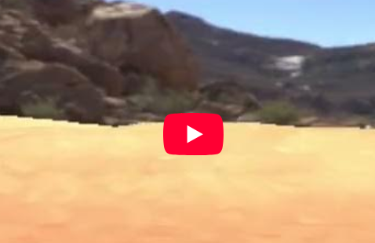
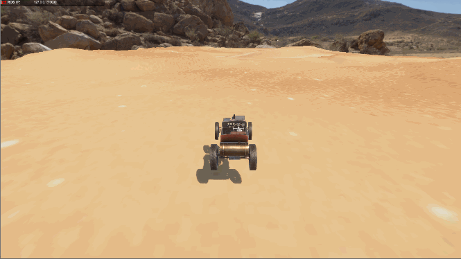

# Desert Scene

## Overview

The main focus was to see how the vehicle deals with dunes, slopes, and bumps at higher speeds while keeping ROS 2 communication and all sensor streams running perfectly.

The entire desert terrain landscape was custom made for this test and used the requested Physics Material settings.

**Evaluation Video**

🎥 **[Watch the car driving in dunes at min velocity of 8 m/s](https://www.youtube.com/watch?v=taptY6ne6p0)**

[](https://www.youtube.com/watch?v=taptY6ne6p0)

---

# 1. Terrain Physics
As requested in the assignment parameters, a dedicated `Custom Ground` physics material was applied directly to the custom designed terrain:
* **Dynamic Friction:** 0.3
* **Static Friction:** 0.4
* **Bounciness:** 0.2
* **Friction Combine:** Minimum
* **Bounce Combine:** Average
  
These values make the ground slippery and challenging, forcing the physics engine to calculate realistic traction losses as the car climbs up dunes.

</td>

</tr>
</table>

<tr>
<td width="100%" align="center" valign="middle">



</td>

---

# 2. ROS Initialization and ROS Bag Creation

Before hitting play in Unity, we need to spin up our ROS 2 environment and start the communication bridge. Open your terminal and run:

```bash
# Set up your ROS 2 environment
source /opt/ros/humble/setup.bash

# Start the connection bridge between Unity and ROS 2
ros2 run ros_tcp_endpoint default_server_endpoint
```

### Checking Active Topics
Once Unity connects to the bridge, it starts streaming live vehicle and sensor data. To see a clean list of all active streams, open a new terminal window and run:

```bash
ros2 topic list
```

If you want to view the actual data values streaming across individual topics in real-time, use the `echo` command:

```bash
# Watch the live vehicle speed and telemetry feedback
ros2 topic echo /feedback

# Monitor simulated global coordinates
ros2 topic echo /gps

# Inspect raw orientation, rotation, and G-forces
ros2 topic echo /imu
```

To check that the data is publishing at the correct speeds, you can measure the topic frequencies with:

```bash
ros2 topic hz /feedback
ros2 topic hz /gps
ros2 topic hz /imu
```

### Recording the Session
We log the entire evaluation run into a folder named `dune1` so we can inspect or replay the data later. To record all relevant control inputs, vehicle states, and sensor channels, run:

```bash
ros2 bag record -o desert1 /input /feedback /gps /imu /camera /lidar /tf /joint_states
```

Once you are done recording, you can review the vehicle's movement and sensor data at any time without booting up Unity. Just run:

```bash
ros2 bag info ~/{ROS PROJECT DIR}/dune1
```

---

# 3. Things Used and Created

### Desert Environment
* A custom terrain layout built from scratch for this test. And its custom physics material as requested.
* Sand dunes and bumps that constantly shift the height of individual wheels.
* Angled hillsides to test vehicle tilt stability.

### Vehicle Setup
* Ackermann steering.
* 4 suspension springs.
* Fully physics driven Rigidbody car body.
* ROS 2 input/output scripts.
* GPS, IMU, Camera, and LiDAR sensors.


---

# 4. Camera Angle

We placed the evaluation camera at a wide angle that clearly showcases how the vehicle interacts with the uneven ground. This strategic position makes it easy to track:
* How the vehicle chassis handles driving up and down sand ridges.
* The physical compression and extension of the suspension springs.
* Body tilt and weight distribution when driving along side slopes.
* Driving speed and momentum.
The camera is positioned far enough away to reveal the upcoming terrain details while keeping the vehicle clearly in focus.


---

# 5. Active Sensors

Every core sensor remains active and streams live data as the vehicle traverses the desert:

* **GPS:** Streams simulated global positioning coordinates.
* **IMU:** Tracks orientation, rotational speed, and G-force impacts. This sensor is crucial for measuring body tilt over dunes.
* **Camera:** Streams a live visual synthetic video feed from the vehicle’s point of view.
* **LiDAR:** Sweeps the hillsides to generate real-time terrain point clouds.
* **Vehicle Feedback:** Transmits actual driving speed, turning angles, and motor feedback.
* **TF:** Maps out the exact spatial relationships between the vehicle body and sensor lenses.
* **Joint States:** Publishes real-time wheel spins and suspension compression values.


Because these streams are perfectly synchronized, this desert test gives us a complete synthetic data capture under realistic off-road driving conditions.

---

# 6. Optimization

The desert scene demands a lot of processing power because it runs terrain calculations, wheel physics, camera rendering, LiDAR sweeps, and ROS 2 network messages all at once.

To maintain a smooth framerate and prevent lag, we used these performance guidelines:
* We limited the size of the terrain mesh to focus strictly on the test track.
* The vehicle physics values were tuned for stability rather than heavy, unnecessary calculations.
* Sensors use fixed time loops (`InvokeRepeating`) to stream data at controlled frequencies instead of overloading Unity's main `Update()` loop.

This disciplined setup keeps the simulation fast and responsive, even when driving at top speeds and broadcasting multiple ROS 2 messages simultaneously.

---

# 7. Challenges

* **Vehicle Stability on Sand Dunes:** Our biggest hurdle was designing terrain that felt uneven and challenging without making the vehicle flip over or spin completely out of control.
* **Suspension Tuning:** Finding the right balance was tough. If the springs were too soft, the chassis would slam violently into the ground on drops. If they were too stiff, the wheels would lose touch with the terrain and bounce unrealistically over small bumps.
* **Terrain Smoothing:** Sharp edges on the map layout caused sudden physics errors. We had to spend extra time smoothing out the dune transitions to keep the car's movements realistic.
