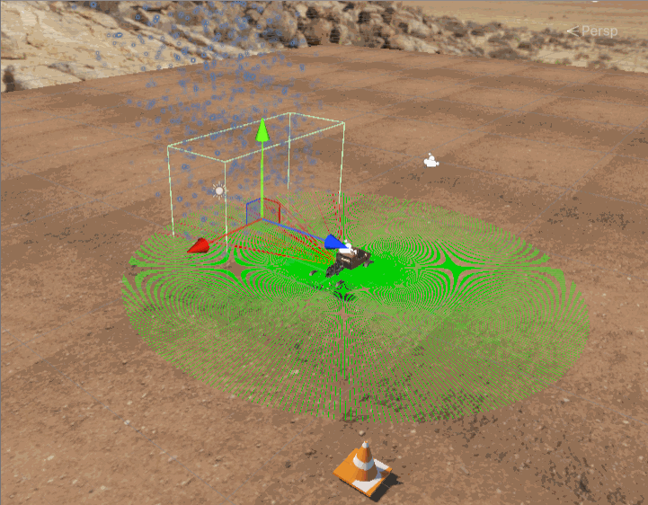
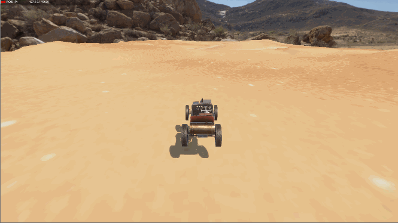
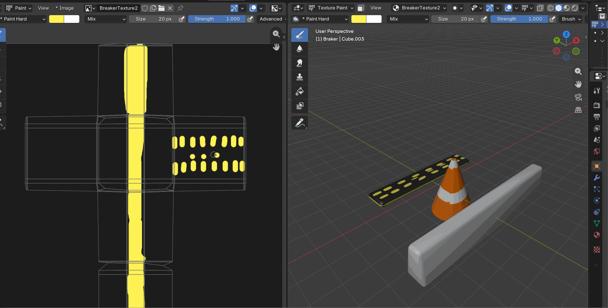
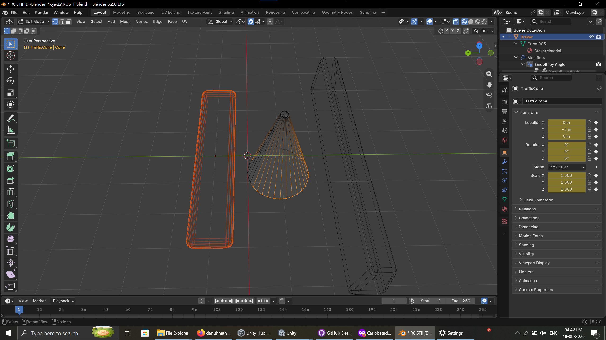
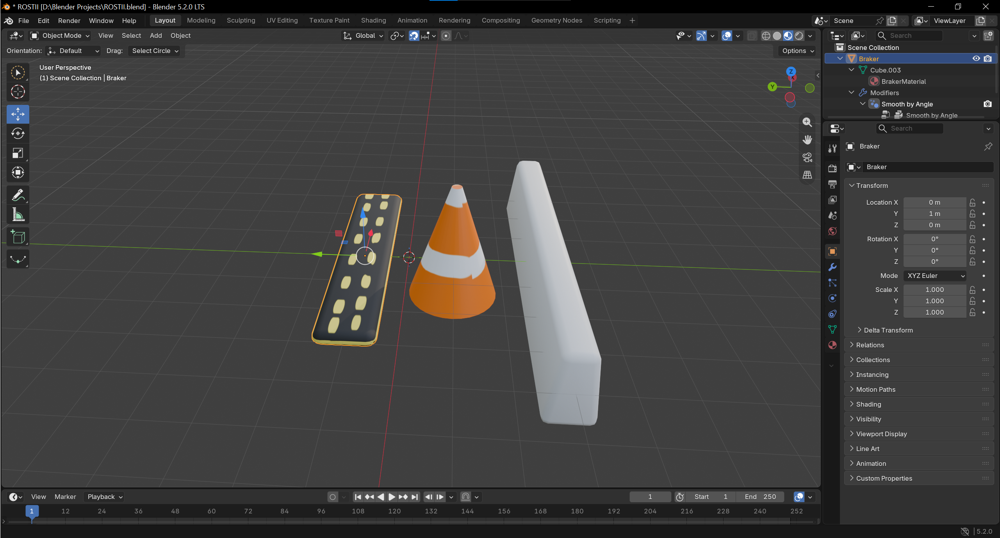
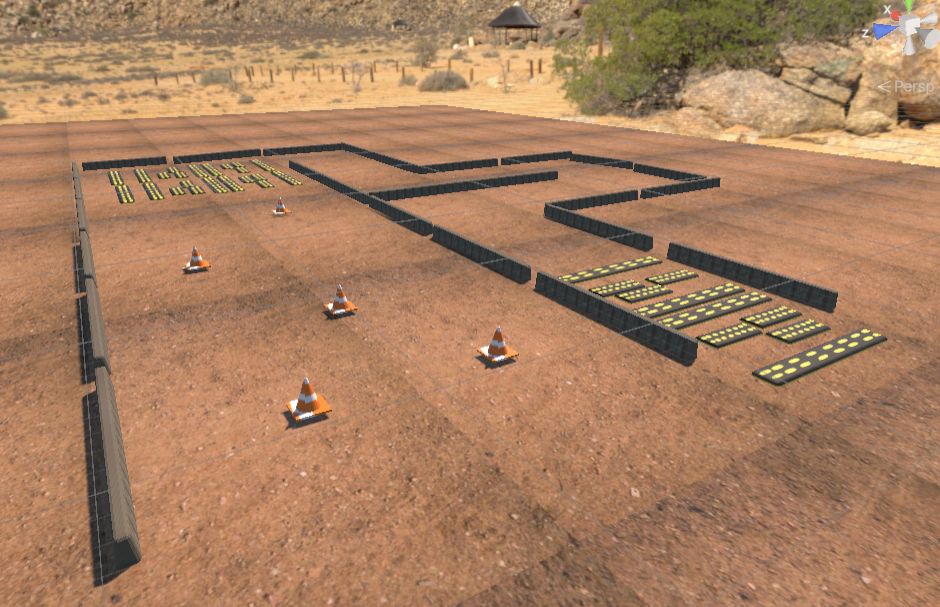

# UGV Unity Simulator

A simulation package that connects an Ackermann steered vehicle made in Unity to ROS2 for vehicle control, synthetic sensor generation, and evaluation data recording.

---


# At a Glance

<table>
  <tr>
    <td align="center" width="33%">
      <h3>🚙 Vehicle & Control</h3>
      
      <br><br>
      ROS 2 controlled Ackermann vehicle navigating obstacles.
    </td>
    <td align="center" width="33%">
      <h3>📡 Sensor Simulation</h3>
      
      <br><br>
      Real-time LiDAR raycasting and sensor visualization.
    </td>
    <td align="center" width="33%">
      <h3>🏜️ Terrain Evaluation</h3>
      
      <br><br>
      Vehicle evaluation across challenging desert terrain.
    </td>
  </tr>
</table>

The simulation combines a ROS2 controlled vehicle with synthetic sensor publishing and dedicated evaluation environments.


---


# What Is Included

### Vehicle

- **Ackermann Steering** — Computes front wheel steering angles for real vehicle like turning.
- **ROS Vehicle Control** — Receives throttle, brake, and steering commands from ROS2.
- **Four Wheel Suspension** — Simulates wheel movement over uneven terrain.

### Sensors

- **GPS** — Publishes the simulated vehicle's geographic coordinates.
- **IMU** — Publishes vehicle orientation, angular velocity, and acceleration.
- **Camera** — Publishes camera images from the vehicle.
- **LiDAR** — Publishes detected 3D point cloud data.

### ROS2

- **Vehicle Input** — Receives control commands through a custom ROS2 message.
- **Vehicle Output** — Publishes the current vehicle state and motion feedback.
- **Sensor Publishing** — Streams simulated GPS, IMU, camera, and LiDAR data.
- **TF Publishing** — Publishes the transform tree between the vehicle and sensor frames.
- **Joint States** — Publishes wheel positions and suspension state.
- **ROS Bag Recording** — Records evaluation scenario data for playback and verification.


---

# [Evaluation Scenarios](Documentation/)

The package includes dedicated scenes covering the evaluation requirements.

### 01 — [ROS Input & Vehicle Feedback](Documentation/Scenario%201%20-%20Vehicle%20input%20from%20ROS.md)

This demonstration shows the complete ROS2 control and feedback loop.

🎥 **[Watch the ROS Input & Vehicle Feedback Demonstration](https://youtu.be/wvYu8hE7G8I)**

**[PLACE ROS INPUT / ROS OUTPUT GIF OR SCREENSHOT HERE]**

```text
ROS2 Input Command
        ↓
Unity Vehicle Controller
        ↓
Ackermann Steering + Vehicle Physics
        ↓
Vehicle State
        ↓
ROS2 Output Feedback
```

The vehicle receives throttle, brake, and steering commands through the custom `ugv_assignment_msgs/Input` message.

The resulting vehicle state, velocity, angular velocity, and steering angles are published back to ROS2 through `ugv_assignment_msgs/Output`.

```text
ugv_assignment_msgs/Input

float64 throttle         # Range: 0.0 to 100.0 (percent)
float64 brake            # Range: 0.0 to 100.0 (percent)
float64 steering_angle   # Range: -0.5 to 0.5 (radians, negative = left)
```

```text
ugv_assignment_msgs/Output

string state                         # One of: "Parking", "Manual", ...
float64 linear_velocity              # m/s
float64 angular_velocity             # # rad/s  
float64 front_left_steering_angle    # radians
float64 front_right_steering_angle   # radians
```

**[PLACE ROS INPUT TERMINAL + UNITY VEHICLE + ROS OUTPUT TERMINAL SCREENSHOT HERE]**

---

### 02 — [Obstacle Course](Documentation/Scenario%202%20-%20Obstacle%20Scene.md)

**[PLACE OBSTACLE COURSE GIF HERE]**

A custom environment for validating vehicle movement between fixed obstacles using vehicle with Ackermann Steering and Wheel Suspensions testing.

🎥 **[Watch the Ackermann steering in obstacle scene](https://youtu.be/lUshATn7ntE)**

**[Optional: PLACE TOP-DOWN OR WIDE SCREENSHOT HERE]**

---


### 03 — [Desert Driving](Documentation/Scenario%203%20-%20Desert%20Scene.md)

**[PLACE DESERT / DUNE GIF HERE]**

The vehicle driving through desert terrain containing dunes and bumps with a minimum velocity of **8 m/s**.

🎥 **[Watch the car driving in dunes at min velocity of 8 m/s](https://youtu.be/taptY6ne6p0)**

**[PLACE VELOCITY / OUTPUT PROOF SCREENSHOT HERE]**

The terrain uses the following physics material:

```text
Dynamic Friction: 0.3
Static Friction: 0.4
Bounciness: 0.2
Friction Combine: Minimum
Bounce Combine: Average
```

**[PLACE UNITY PHYSICS MATERIAL INSPECTOR SCREENSHOT HERE]**

---

### 04 — [Sand Synthetic Data](Documentation/Scenario%204%20-%20Sand%20Synthetics%20Data.md)

Sand particles are detected with LiDar sensor and captured from Camera sensor. All of this is ROS bag for synthetic data evaluation.

🎥 **[Watch the Sand detection in LiDar and Camera | Synthetic Data ](https://youtu.be/5GQZkRiDoXE)**

| Camera                                     | LiDAR                                     |
| ------------------------------------------ | ----------------------------------------- |
| **[PLACE CAMERA PARTICLE IMAGE/GIF HERE]** | **[PLACE LIDAR PARTICLE IMAGE/GIF HERE]** |

Vehicle movement is not required for this scene. The focus is on how the particles appear in the generated sensor outputs.

---

# [Project & ROS Setup](Documentation/Project%20&%20ROS%20Setup.md)

The repository is delivered as a Unity Package Manager compatible package. The repository does not require cloning the full Unity project.
This guide covers the dependencies and ROS2 setup required to connect the Unity simulation with the ROS2 environment.

## Requirements

- Unity 3D - URP (Universal Render Pipeline)
- ROS2 Humble
- Unity Robotics ROS-TCP Connectors

---

## 1. Install ROS-TCP Connector

The Unity simulation uses the ROS-TCP Connector to communicate with ROS2.

In your Unity project:

1. Open **Window → Package Manager**.
2. Click the **+** button.
3. Select **Add package from git URL...**
4. Enter:

```text
https://github.com/Unity-Technologies/ROS-TCP-Connector.git?path=/com.unity.robotics.ros-tcp-connector
```
## 2. Start the ROS endpoint in Linux

```bash
source /opt/ros/[DISTRO]/setup.bash
ros2 run ros_tcp_endpoint default_server_endpoint
```

## 3. Install the Package (Recommended Method)

> **Recommended:** Download the repository as a ZIP file rather than importing it directly using the Git URL, to avoid scene read only issue.

1. Download the repository as a ZIP.
   ```text
   GitHub → Code → Download ZIP
2. Extract the ZIP to any location on your computer. **Extract the ZIP**.
3. In Unity, open: Window → Package Manager → + → Add package from disk...
4. Navigate to the extracted repository and select: **package.json**

## 4. Open any evaluation scene

```text
Packages/
└── TerraSim Assignment/
    └── Runtime/
        └── Scene/
            ├── ObstacleScene
            ├── DuneScene
            └── SandScene
```

Start the ROS endpoint, open the required scene, and press **Play**.

---

# ROS Interface

### Published Data

| Category | Topic                 | Type                         |   Rate | Description                                      |
| -------- | --------------------- | ---------------------------- | -----: | ------------------------------------------------ |
| Feedback | `/vehicle/output`     | `ugv_assignment_msgs/Output` |  50 Hz | Publishes vehicle state feedback.                |
| GPS      | `/gps`                | `sensor_msgs/NavSatFix`      |  10 Hz | Publishes simulated vehicle coordinates.         |
| IMU      | `/imu`                | `sensor_msgs/Imu`            | 100 Hz | Publishes vehicle orientation and motion data.   |
| Camera   | `/camera`             | `sensor_msgs/Image`          |  30 Hz | Publishes the simulated camera image.            |
| LiDAR    | `/lidar`              | `sensor_msgs/PointCloud2`    |  10 Hz | Publishes the simulated LiDAR point cloud.       |
| TF       | `/tf`                 | `tf2_msgs/TFMessage`         |  50 Hz | Publishes the vehicle and sensor transform tree. |
| Joints   | `/jointStates`        | `sensor_msgs/JointState`     |  50 Hz | Publishes wheel joint positions.                 |

---

# Bonus Point - Custom Obstacle Assets

The obstacle assets used in the Obstacle scene were modelled and textured specifically for this project using blender.
The original Blender source file is included as supporting evidence.
> `ROSTII.blend`

<table>

<tr>
<td width="50%" align="center">

<h3>1. Modelling</h3>



Initial obstacle asset creation and modelling in Blender.

</td>

<td width="50%" align="center">

<h3>2. Edit Mode</h3>



Geometry and mesh editing used to shape the obstacle assets.

</td>
</tr>

<tr>
<td width="50%" align="center">

<h3>3. Texture Work</h3>



Custom texture and material work applied to the obstacle assets.

</td>

<td width="50%" align="center">

<h3>4. Unity Integration</h3>



The finished assets integrated into the Unity obstacle evaluation scene.

</td>
</tr>

</table>

The unique texture painting and source `.blend` file are included to demonstrate that these assets were created and edited for this project rather than only imported as finished models.

---

# Key Takeaways

This project gave me experience beyond just Unity. It helped connect 3D simulation with robotics tools and workflows.
Some of the biggest things learned were:

* **Working with Linux and WSL:** Setting up and using Ubuntu through Windows Subsystem for Linux (WSL), running ROS 2 commands, managing packages, workspaces, and debugging communication between Windows and Linux.
* **Robotics Sensor Simulation:** Learning how GPS, IMU, Camera, LiDAR, TF, and Joint States can be generated from a simulated vehicle.
* **ROS Bags:** Learning how to record, replay, and verify simulation data without having to run the complete Unity scene again.
* **Debugging Complex Systems:** The toughest part was making multiple systems work together at the same time — Unity physics, ROS communication, custom messages, sensors, terrain, and data publishing.

Personally, a huge level up in terms of knowledge, debugging and problem solving.

---

# Documentation

* [App & Architecture](Documentation/App%20&%20Architecture.md)
* [Project & ROS Setup](Documentation/Project%20&%20ROS%20Setup.md)
* [Scenario 1 - Vehicle Input from ROS](Documentation/Scenario%201%20-%20Vehicle%20input%20from%20ROS.md)
* [Scenario 2 - Obstacle Scene](Documentation/Scenario%202%20-%20Obstacle%20Scene.md)
* [Scenario 3 - Desert Scene](Documentation/Scenario%203%20-%20Desert%20Scene.md)
* [Scenario 4 - Sand Synthetic Data](Documentation/Scenario%204%20-%20Sand%20Synthetics%20Data.md)

---


# Downloading the Recordings & ROS Bags

Each evaluation scenario is accompanied by a video recording and ROS bag data.

* [Deliverable Videos](https://drive.google.com/drive/folders/1q0VKqjq1ESsRNiyFxvO75CF-hyM2OP09?usp=drive_link)
* [ROS Bag Recording](https://drive.google.com/drive/folders/1_cd8MHfxg_wbpx2z07jcI_G5zWwmRzHg?usp=drive_link)
* [Document]((https://docs.google.com/document/d/175V-mASgo41eBvmAoTRWa6eO7YD5vrKG/edit?usp=drive_link&ouid=116760820206679628994&rtpof=true&sd=true)

---

# References

Unity3D, https://github.com/Unity-Technologies/ROS-TCP-Connector, ROS2 Humble, RViz 2, Blender, OBS Studio, LiCEcap, Davinci Resolve 
